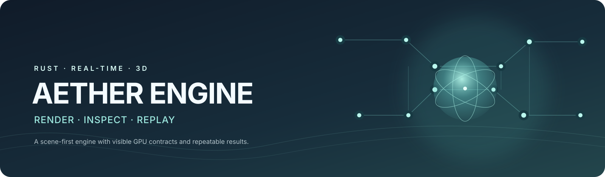
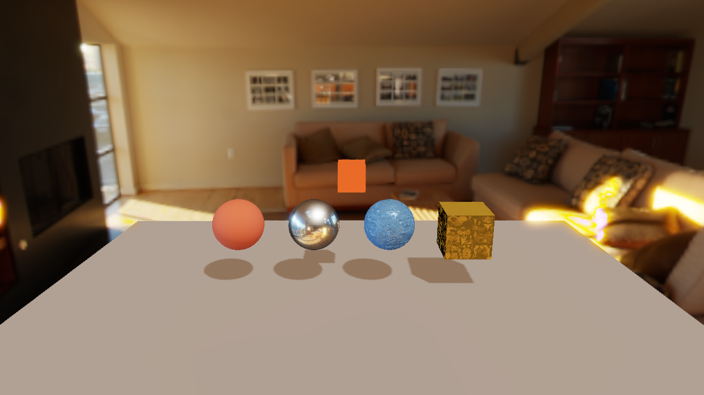
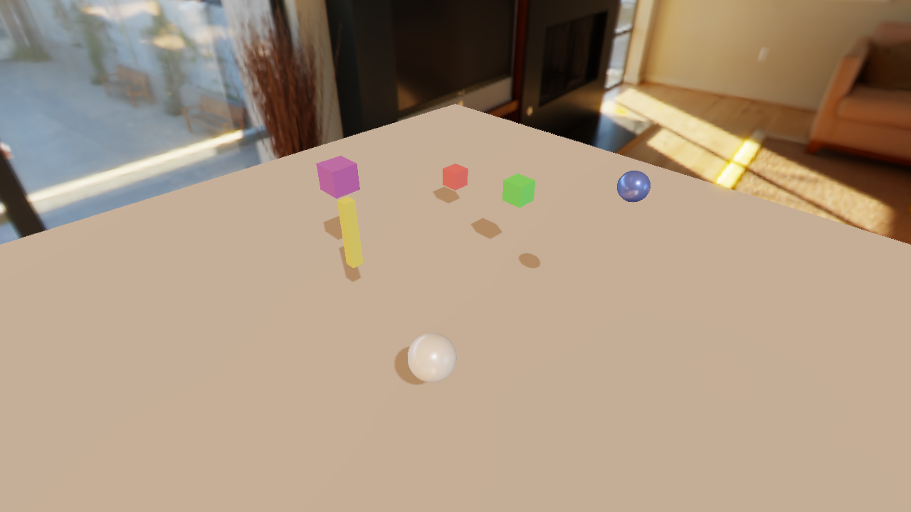
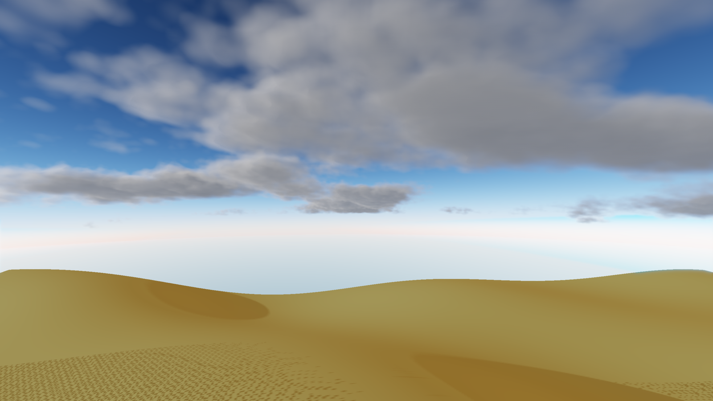
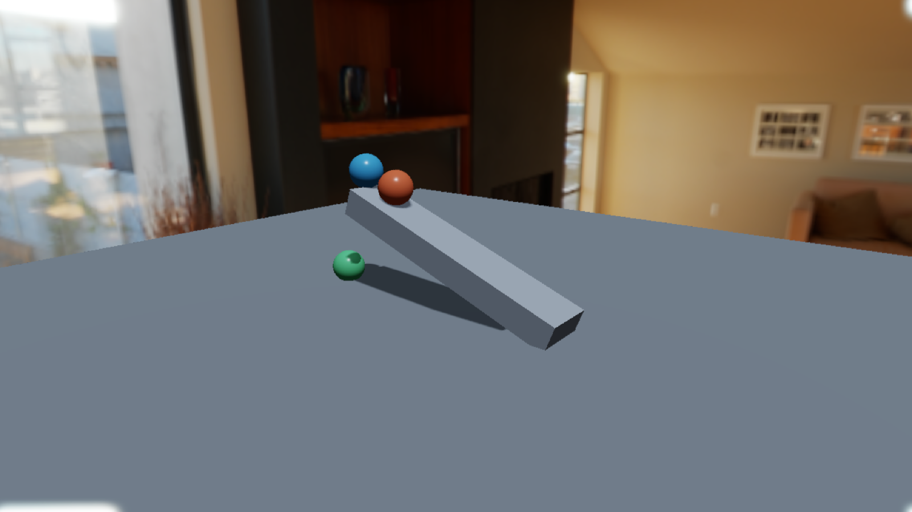
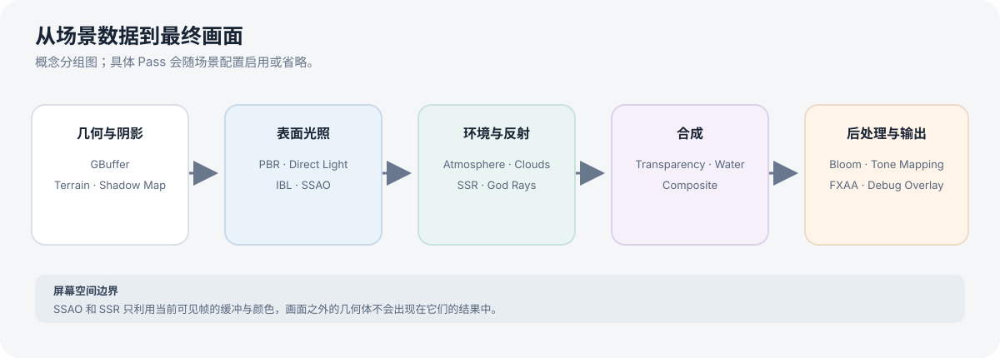

<p align="center">
  
</p>

<p align="center">
  <a href="README.md">English</a> · <a href="README.zh-CN.md">简体中文</a>
  <br><br>
  
  
  
  
</p>

**Aether Engine is a Rust real-time 3D engine built around one idea: make the frame explain itself.** Explore a scene, inspect how its render passes depend on GPU resources, change it in the editor, and replay simulation at a fixed time.

It is an actively developed engine project, not a production-ready general-purpose engine. The current scope focuses on a non-ray-traced renderer, a usable scene editor, deterministic simulation, and evidence that makes changes easier to review.

<p align="center">
  <a href="#see-it-run">Run a scene</a> ·
  <a href="#what-makes-aether-different">What makes it different</a> ·
  <a href="docs/engine/README.md">Engine docs</a> ·
  <a href="docs/plans/2026-09-17-non-raytracing-engine-roadmap/index.html">Live roadmap</a>
</p>

## The engine, in frames

<table>
  <tr>
    <td width="50%"><br><sub><b>Materials</b> · compare PBR response under IBL</sub></td>
    <td width="50%"><br><sub><b>Lighting</b> · inspect materials, light, and shadow together</sub></td>
  </tr>
  <tr>
    <td width="50%"><br><sub><b>Atmosphere</b> · volumetric clouds over terrain</sub></td>
    <td width="50%"><br><sub><b>Simulation</b> · rigid bodies on a ramp</sub></td>
  </tr>
</table>

## What makes Aether different

### A render pipeline you can inspect

Each pass declares the GPU resources it reads and writes. The pipeline builder uses those declarations to order work and connect typed resource handles. When a dependency is missing or cyclic, the problem is visible in the pipeline contract and graph evidence—not hidden behind a long list of draw calls.



### One scene from editor to GPU

Scenes load from readable RON files into a `hecs` world. The editor changes that world; an explicit extract step turns it into immutable frame data for rendering. The same scene can be saved, reopened, and used as a focused example or verification case.

### Time is part of the test input

Physics and particles advance on fixed steps. Animation accepts explicit seek times and publishes a frame snapshot, so a pose can be replayed and compared. T7 adds owned glTF data, four-influence GPU skinning, a 128-joint palette, and per-primitive fallback for unsupported or oversized skins.

### Visual results come with evidence

Visual cases pin the scene, camera, time, and feature flags. Their reports preserve the rendered image and diff alongside render-graph, metrics, hashes, and process diagnostics. A screenshot can show what changed; the case contract and report help explain why.

### GPU ownership has a clear boundary

Asset workers decode CPU data. The launcher commits GPU resources at a frame boundary, using asset generations to reject stale work and keep the last known good resource available after a failed reload.

The current renderer covers deferred PBR, IBL, directional and local lights, shadows, transparency, post-processing, terrain, water, atmosphere, and volumetric clouds. SSAO and SSR are screen-space effects, so they only use information visible to the current camera; ray tracing is outside the project scope.

## Current project status

<!-- ROADMAP_STATUS:START -->
**Status synced 2026-10-11.** Automated checks and human acceptance are tracked separately; a capture alone does not approve visual results.

| Task | Implementation / automation / acceptance | Remaining | Evidence |
| --- | --- | --- | --- |
| T0 · Verification foundation | Implemented; automation passed; partially accepted | Review the 25 remaining visual candidates; promote only individually approved references. | [T0 execution package](docs/plans/2026-09-17-non-raytracing-engine-roadmap/t0-foundation.html) · [T0 candidate capture report (25 scenes)](docs/plans/2026-09-17-non-raytracing-engine-roadmap/t0-visual-candidate-report-20261011.md) |
| T1 · Editor transactions and snapshots | Implemented; automation passed; accepted | No known open items | [T1 execution package](docs/plans/2026-09-17-non-raytracing-engine-roadmap/t1-editor.html) |
| T2 · Multiple lights | Implemented; automation passed; partially accepted | Review the three-local-light candidate; low-limit hardware remains covered by a synthetic capability matrix. | [T2 execution package](docs/plans/2026-09-17-non-raytracing-engine-roadmap/t2-lighting.html) |
| T3 · Material resolution and PBR consumers | Implemented; automation passed; accepted | No known open items | [T3 execution package](docs/plans/2026-09-17-non-raytracing-engine-roadmap/t3-material.html) |
| T4 · Transparency and composite | In progress; automation partial; human review pending | Review T4.1/T4.2 candidates and verify water composition, resize, and scene-switch interaction. | [T4 execution package](docs/plans/2026-09-17-non-raytracing-engine-roadmap/t4-transparent.html) |
| T5 · CPU particles | In progress; automation partial; partially accepted | Finish typed runtime statistics, 4K performance delta, and flame/smoke/dust readability review. | [T5 execution package](docs/plans/2026-09-17-non-raytracing-engine-roadmap/t5-particles.html) |
| T6 · Physics lifecycle | Implemented; automation passed; human review pending | Manually confirm the actual UI click feel and review the 100-body capture before promoting it from reference-pending. | [T6 execution package](docs/plans/2026-09-17-non-raytracing-engine-roadmap/t6-physics.html) |
| T7 · glTF and animation | Implemented; automation passed; accepted | Optional: inspect the Inspector playback controls separately; core T7 is accepted. | [T7 execution record](docs/plans/2026-09-17-non-raytracing-engine-roadmap/t7.2-execution.md) |
| T8 · Assets, prefabs, and hot reload | Implemented; automation passed; accepted | No known open items | [T8 completion record](docs/plans/2026-09-17-non-raytracing-engine-roadmap/t8-assets-completion.md) |
| T9 · Performance and visibility | Implemented; automation partial; partially accepted; research only; production NO-GO | Rebuild the clean pinned v0.1 paired baseline for T9.1; T9.4 remains research-only and production NO-GO. | [T9.1 execution record](docs/plans/2026-09-17-non-raytracing-engine-roadmap/t9.1-execution.md) · [T9.4 decision record](docs/plans/2026-09-17-non-raytracing-engine-roadmap/t9.4-execution.md) |
<!-- ROADMAP_STATUS:END -->

See the [roadmap](docs/plans/2026-09-17-non-raytracing-engine-roadmap/index.html) for slice status, outstanding verification, and evidence links. The project CI entry point is `./scripts/verify-ci.sh`; a successful run is reported by that command rather than implied by roadmap acceptance.

The editor workflow has also grown beyond scene selection: the **Project** workspace browses the project's folders and indexed resources, while **Log** exposes searchable runtime diagnostics. Both live beside the viewport; the workspace height and the Folders/Resources split can be resized. The first EW3 slice supports dragging a single OBJ into the viewport with undo/redo. Material and texture assignment by drag-and-drop remains planned. See the [editor workflow plan](docs/plans/2026-10-11-editor-workflow/plan.md), [editor guide](docs/engine/editor.md), and [EW3 screenshot report](docs/plans/2026-10-11-editor-workflow/ew3-screenshot-validation.html).

## See it run

You need a stable Rust toolchain (the workspace declares Rust 1.78) and a GPU/backend supported by `wgpu`.

```bash
git clone https://github.com/ruochenhua/AetherEngine.git
cd AetherEngine
cargo run -p aether-launcher
```

The launcher opens the scene browser. Open a scene directly to jump into a feature:

```bash
# PBR material grid
cargo run -p aether-launcher -- --scene scenes/24_t3_pbr_material_grid.ron

# Volumetric clouds
cargo run -p aether-launcher -- --scene scenes/13_clouds.ron

# Skeletal animation
cargo run -p aether-launcher -- --scene scenes/t7_gltf_actor.ron
```

## Explore by topic

| Start here | What you will find |
| --- | --- |
| [Architecture](docs/engine/architecture.md) | ECS, frame extraction, and resource-declared render scheduling |
| [Rendering](docs/engine/rendering.md) | PBR, lighting, shadows, SSR/SSAO, water, terrain, and clouds |
| [Editor](docs/engine/editor.md) | Project resource browser, runtime log, hierarchy, inspector, transforms, and save flow |
| [Simulation](docs/engine/simulation.md) | Physics, particles, playback controls, and fixed-step behavior |
| [Scenes and assets](docs/engine/scenes-assets.md) | RON scenes, models, textures, and asset paths |
| [Roadmap](docs/plans/2026-09-17-non-raytracing-engine-roadmap/index.html) | Current milestones, slices, and acceptance evidence |
| [Engineering rules](docs/engineering-governance.md) | Code health and required verification |
| [Visual test workflow](docs/agents/visual-test-workflow.md) | Repeatable captures, reports, and regression checks |

## Run the project checks

```bash
./scripts/verify-ci.sh
```

For a render-affecting change, run the relevant scene regression as well; for example:

```bash
./scripts/verify-regression.sh --scene 13_clouds
```

The workspace license is [`MIT OR Apache-2.0`](Cargo.toml).
