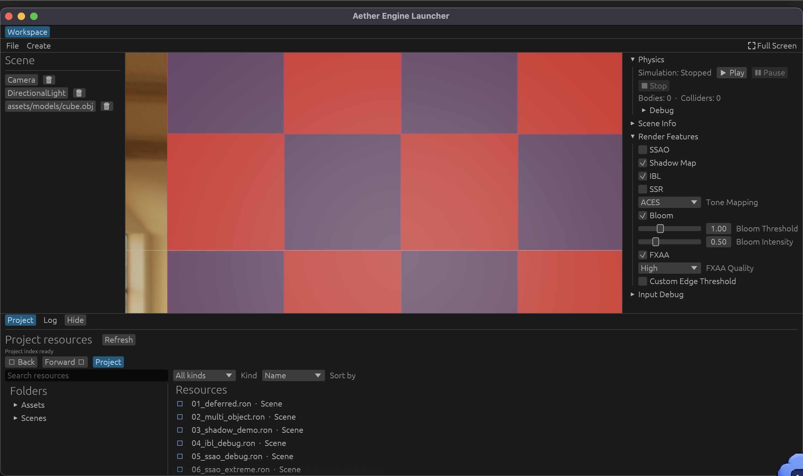

<p align="center">
  
</p>

<p align="center">
  <a href="README.md">English</a> · <a href="README.zh-CN.md">简体中文</a>
  <br><br>
  
  
  
  
</p>

**Aether Engine 是一个 Rust 实时 3D 引擎，我们希望让每一帧都能解释自己。**你可以打开场景，检查渲染 Pass 如何依赖 GPU 资源，在编辑器里修改场景，再用固定时间重放模拟。

这是一个持续开发中的引擎研发项目，尚不是生产就绪的通用引擎。近期编辑器工作已把项目资源浏览、资源预览、运行日志、安全导入与放置、场景未保存保护和可发现的视口操作连接成一个工作流。

<p align="center">
  <a href="#运行一个场景">运行一个场景</a> ·
  <a href="#aether-的独特点">Aether 的独特点</a> ·
  <a href="#编辑器工作流已进入引擎">编辑器工作流</a> ·
  <a href="docs/engine/README.md">引擎文档</a> ·
  <a href="docs/plans/2026-09-17-non-raytracing-engine-roadmap/index.html">项目路线图</a>
</p>

## 看看引擎在渲染什么

<table>
  <tr>
    <td width="50%"><br><sub><b>材质</b> · 在 IBL 环境中比较 PBR 响应</sub></td>
    <td width="50%"><br><sub><b>光照</b> · 同时观察材质、灯光和阴影</sub></td>
  </tr>
  <tr>
    <td width="50%"><br><sub><b>大气</b> · 地形上空的体积云</sub></td>
    <td width="50%"><br><sub><b>模拟</b> · 斜坡上的刚体运动</sub></td>
  </tr>
</table>

## Aether 的独特点

### 可检查的渲染流程

每个 Pass 都声明自己读取和写入的 GPU 资源。Pipeline Builder 根据声明安排执行顺序，并通过带类型的资源句柄连接 Pass。依赖缺失或形成环时，可以从管线契约和图示证据中定位，而不必只靠观察最终画面。


### 从编辑器到 GPU 使用同一份场景

场景从可读的 RON 文件载入 `hecs` 世界。编辑器修改这份场景数据；渲染前的 Extract 阶段将它转换成不可变的帧数据。相同的场景可以保存、重开，也可以作为专项示例或验证用例。

### 时间是测试输入的一部分

物理和粒子使用固定步长推进。动画支持显式 seek 时间并发布帧快照，因此一个姿势可以重复播放和比较。T7 加入了 owned glTF 数据、四权重 GPU 蒙皮、128-joint palette，以及对不支持或超限 skin 的逐 primitive 回退。

### 视觉结果附带验证证据

VisualCase 固定场景、相机、时间和功能开关。报告会保留渲染图与差异图，以及 RenderGraph、指标、哈希和进程诊断。截图能展示结果变化；用例契约和报告还能帮助解释变化原因。

### GPU 资源有明确的所有权边界

资源 worker 只解码 CPU 数据。Launcher 在帧边界提交 GPU 资源，并通过 asset generation 丢弃过期结果；reload 失败时，原有可用资源仍能继续使用。

当前渲染器覆盖延迟 PBR、IBL、方向光与局部光、阴影、透明、后处理、地形、水体、大气和体积云。SSAO 与 SSR 是屏幕空间效果，只能使用当前相机可见的信息；光线追踪不在项目范围内。

## 编辑器工作流已进入引擎

编辑器现在把项目内容、场景编辑和运行反馈放在同一个工作区中：

- **浏览与检查资源：** Project 面板索引 `scenes/` 和 `assets/`，支持目录导航、搜索、类型筛选，以及受支持图片和模型的预览。Folders 与 Resources 两列可分别拖动调整宽度。
- **导入与放置：** 可将受支持的 OBJ 网格拖入视口，为对象赋予支持的材质和纹理，并撤销/重做编辑操作。Project 面板支持创建项目目录、多选导入 PNG、JPEG、自包含 GLB、OBJ 和 MTL；也可把文件或文件夹直接拖入资源列表，保留文件夹层级和 OBJ 材质依赖。本次编辑器会话会记住上次导入目录。
- **保护场景内容：** New、Open、Save、Save As、从 Project 打开场景和关闭窗口共用 Save / Discard / Cancel 流程。场景加载采用事务式切换；加载失败时当前场景仍保留。
- **查看运行反馈：** Log 面板采集结构化诊断，支持在编辑器内搜索和查看；清空或筛选当前列表不会停止日志采集。
- **操作视口：** 鼠标或触控板左键拖动旋转视角，按住左键并使用 WASD/QE 飞行；中键拖动平移；滚轮/触控板滚动推近或拉远；`F` 聚焦所选对象；Option + 左键拖动绕所选对象旋转。视口 Tips 对所有指针显示同一套操作。

<p align="center">
  
  <br><sub>Project 工作区截图（2026-10-15）：目录树、可搜索资源列表与可调尺寸的工作区。</sub>
</p>

**仍在推进：** 为保证运行时资源引用安全，Move、Rename、Delete 仍处于禁用状态。独立的资源预览分页列入 EW6 规划。左键加 WASD 的触控板飞行操作仍需在目标设备上实际验证。

## 当前项目进度

<!-- ROADMAP_STATUS_ZH:START -->
**状态同步日期：2026-10-11。** 人工验收与自动验证分开记录；截图采集本身不会自动通过视觉验收。

| 任务 | 实现 / 自动验证 / 验收 | 剩余项 | 证据 |
| --- | --- | --- | --- |
| T0 · 验证基础与确定性时间 | 实现完成；自动验证 通过；部分验收 | 逐项复核剩余 25 张视觉候选；仅将明确通过的画面登记为 reference。 | [T0 执行包](docs/plans/2026-09-17-non-raytracing-engine-roadmap/t0-foundation.html) · [T0 候选采集报告（25 个场景）](docs/plans/2026-09-17-non-raytracing-engine-roadmap/t0-visual-candidate-report-20261011.md) |
| T1 · 编辑器事务与快照 | 实现完成；自动验证 通过；已验收 | 无已知遗留 | [T1 执行包](docs/plans/2026-09-17-non-raytracing-engine-roadmap/t1-editor.html) |
| T2 · 多光源 | 实现完成；自动验证 通过；部分验收 | 人工复核三局部光候选；低限设备目前由合成能力矩阵覆盖。 | [T2 执行包](docs/plans/2026-09-17-non-raytracing-engine-roadmap/t2-lighting.html) |
| T3 · 材质解析与 PBR 消费链 | 实现完成；自动验证 通过；已验收 | 无已知遗留 | [T3 执行包](docs/plans/2026-09-17-non-raytracing-engine-roadmap/t3-material.html) |
| T4 · 透明与 Composite 管线 | 进行中；自动验证 部分通过；待人工验收 | 人工复核 T4.1/T4.2 候选，并验收水面构图、窗口缩放和场景切换交互。 | [T4 执行包](docs/plans/2026-09-17-non-raytracing-engine-roadmap/t4-transparent.html) |
| T5 · CPU 粒子 | 进行中；自动验证 部分通过；部分验收 | 补齐 typed runtime 统计与 4K 性能差值，并复核火焰、烟和尘的辨识度。 | [T5 执行包](docs/plans/2026-09-17-non-raytracing-engine-roadmap/t5-particles.html) |
| T6 · 物理生命周期 | 实现完成；自动验证 通过；待人工验收 | 仍需人工确认实际 UI 点击体验，并审核 100-body 候选截图后再决定是否登记为 reference。 | [T6 执行包](docs/plans/2026-09-17-non-raytracing-engine-roadmap/t6-physics.html) |
| T7 · glTF 与动画 | 实现完成；自动验证 通过；已验收 | 可选：单独检查 Inspector 播放控件；T7 核心范围已验收。 | [T7 执行记录](docs/plans/2026-09-17-non-raytracing-engine-roadmap/t7.2-execution.md) |
| T8 · 资产、Prefab 与热重载 | 实现完成；自动验证 通过；已验收 | 无已知遗留 | [T8 完成记录](docs/plans/2026-09-17-non-raytracing-engine-roadmap/t8-assets-completion.md) |
| T9 · 性能与可见性 | 实现完成；自动验证 部分通过；部分验收；仅研究；生产 NO-GO | 为 T9.1 重建 clean pinned v0.1 配对基线；T9.4 仅限研究，生产决策为 NO-GO。 | [T9.1 执行记录](docs/plans/2026-09-17-non-raytracing-engine-roadmap/t9.1-execution.md) · [T9.4 决策记录](docs/plans/2026-09-17-non-raytracing-engine-roadmap/t9.4-execution.md) |
<!-- ROADMAP_STATUS_ZH:END -->

切片状态、待处理验证和证据链接见[路线图](docs/plans/2026-09-17-non-raytracing-engine-roadmap/index.html)。项目 CI 入口为 `./scripts/verify-ci.sh`；只有该命令成功运行后才表示 CI 验证通过，路线图验收状态本身不代表 CI 已通过。

编辑器工作流的切片状态、验收边界与后续计划见[编辑器工作流计划](docs/plans/2026-10-11-editor-workflow/plan.md)、[编辑器指南](docs/engine/editor.md)、[EW3 截图报告](docs/plans/2026-10-11-editor-workflow/ew3-screenshot-validation.html)和[视口交互合同](docs/plans/2026-10-11-editor-workflow/editor-interaction-contract.md)。

## 运行一个场景

需要稳定版 Rust 工具链（workspace 声明 Rust 1.78）以及 `wgpu` 支持的 GPU 和图形后端。

```bash
git clone https://github.com/ruochenhua/AetherEngine.git
cd AetherEngine
cargo run -p aether-launcher
```

启动后会打开场景浏览器。也可以直接进入专项场景：

```bash
# PBR 材质网格
cargo run -p aether-launcher -- --scene scenes/24_t3_pbr_material_grid.ron

# 体积云
cargo run -p aether-launcher -- --scene scenes/13_clouds.ron

# 骨骼动画
cargo run -p aether-launcher -- --scene scenes/t7_gltf_actor.ron
```

## 按主题探索

| 从这里开始 | 内容 |
| --- | --- |
| [架构](docs/engine/architecture.md) | ECS、帧数据提取和基于资源声明的渲染调度 |
| [渲染](docs/engine/rendering.md) | PBR、光照、阴影、SSR/SSAO、水体、地形和体积云 |
| [编辑器](docs/engine/editor.md) | Project 资源浏览器、运行日志、Hierarchy、Inspector、变换编辑和保存 |
| [模拟](docs/engine/simulation.md) | 物理、粒子、播放控制和固定步长 |
| [场景与资源](docs/engine/scenes-assets.md) | RON 场景、模型、纹理和资源路径 |
| [路线图](docs/plans/2026-09-17-non-raytracing-engine-roadmap/index.html) | 当前里程碑、切片和验收证据 |
| [工程规范](docs/engineering-governance.md) | 代码健康度与必需验证 |
| [视觉测试流程](docs/agents/visual-test-workflow.md) | 可重复截图、报告和回归检查 |

## 运行项目检查

```bash
./scripts/verify-ci.sh
```

修改渲染后，还应运行对应场景回归，例如：

```bash
./scripts/verify-regression.sh --scene 13_clouds
```

Workspace 使用 [`MIT OR Apache-2.0`](Cargo.toml) 许可证。
