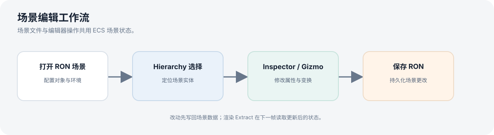

# 编辑器与场景操作

Launcher 是引擎的交互式入口，提供场景浏览和基础编辑能力。它同时也是查看专项场景、观察渲染效果和重复运行模拟的工具。

## 主要面板与交互

- **场景浏览器**：从示例场景中选择要载入的 RON 文件，也可通过命令行直接指定场景。
- **Project 资源浏览器**：浏览 `scenes/` 与 `assets/`，使用目录树、路径历史、搜索、类型筛选和排序查找资源；选择资源查看详情和支持的图片/模型预览，不会清除当前 Scene 实体选择。Folders 与 Resources 之间的分割条可拖动调整宽度。
- **Log**：查看和过滤运行时诊断，按等级、类别和文本搜索；暂停自动滚动或清空当前视图不会停止底层日志采集，日志也会写入项目诊断文件。
- **Hierarchy**：浏览场景中的实体并选择对象。
- **Inspector**：查看和修改选中对象的可编辑属性；具体显示项依实体类型而异。
- **视口交互**：鼠标或触控板使用统一的左键、键盘和滚动输入操作视口；左上角 Tips 显示同一套快捷操作。
- **场景文件**：New、Open、Save、Save As、从 Project 打开场景和关闭窗口共用 Save / Discard / Cancel 确认。场景先完成加载和初始化，再替换当前文档；失败时保留原场景。模拟运行期间需先 Stop 才能切换场景。
- **资源导入与拖放**：可创建项目目录，导入 PNG、JPEG 和自包含 GLB；支持的 OBJ 网格可拖入视口，MaterialAsset 和纹理可拖到兼容属性槽。相关场景编辑支持 Undo/Redo。
- **资源引用预览**：Project 可显示只读的 Used by / Depends on 分析。Move、Rename、Delete 尚未开放，原因是运行时资源持有者和生命周期还没有完整的安全迁移合同。

Project 与 Log 面板通过工作区标签切换；底部工作区可调整高度，Project 内部的 Folders/Resources 分栏也可独立拖动调整。当前使用固定工作区布局，不支持任意浮动停靠或保存多套布局。资源在独立预览分页打开属于后续 EW6 规划，当前仍通过 Project 详情区域预览。

## 常用操作

| 输入 | 操作 |
| --- | --- |
| 按住左键 + `W A S D` / `Q E` | 飞行移动视角 |
| 左键拖动 | 旋转观察视角；松开后停止旋转 |
| 中键拖动 | 平移视口 |
| 滚轮 / 触控板滚动 | 沿视线推近 / 拉远 |
| `Shift` + 滚动 | 垂直平移视口 |
| `Option` + 左键拖动 | 绕选中对象旋转 |
| `F` | 聚焦所选对象 |
| 左键单击 | 选择对象 |
| 拖动 Gizmo | 编辑对象变换 |
| `Delete` | 删除选中对象 |

触控板沿用同一套视口控制：按住触控板左键并按 `W A S D` / `Q E` 飞行，滚动推拉视角。视口操作提示不再区分鼠标和触控板模式。飞行时即使 Inspector 或 Project 的文本框仍有键盘焦点，视口也会优先接收移动按键；松开左键后，文本输入恢复正常。

在 Project 面板中，可拖动 Folders 与 Resources 中间的分割条调整目录树宽度；拖动工作区上边缘可调整底部面板高度。File 菜单可创建和打开场景、保存或另存为；如果文档有未保存改动，先选择 Save、Discard 或 Cancel。

界面布局或快捷键会随开发迭代调整；若输入冲突，优先以 Launcher 当前界面和代码实现为准。

## 建议体验

先打开材质场景 [`24_t3_pbr_material_grid.ron`](../../scenes/24_t3_pbr_material_grid.ron)，在 Hierarchy 中切换对象并检查 Inspector；再尝试打开、编辑并保存一份 RON 场景。

物理模拟的 Play、Pause、Stop 和碰撞体可视化集中说明在[物理与粒子](simulation.md)。
